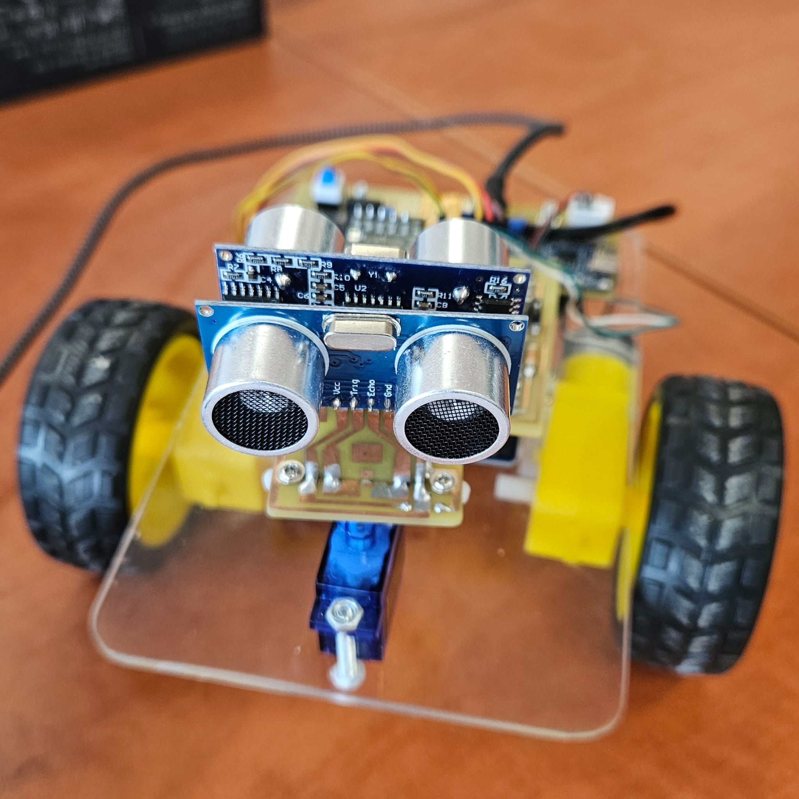
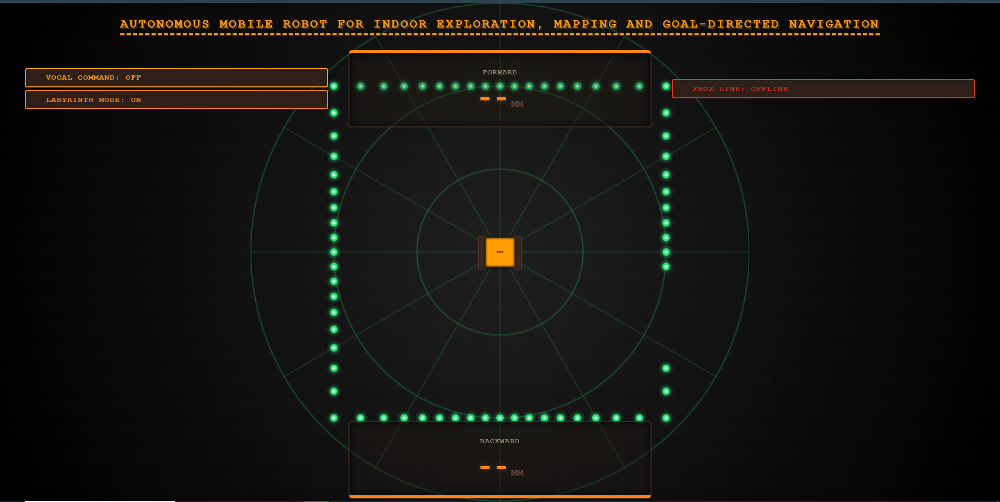
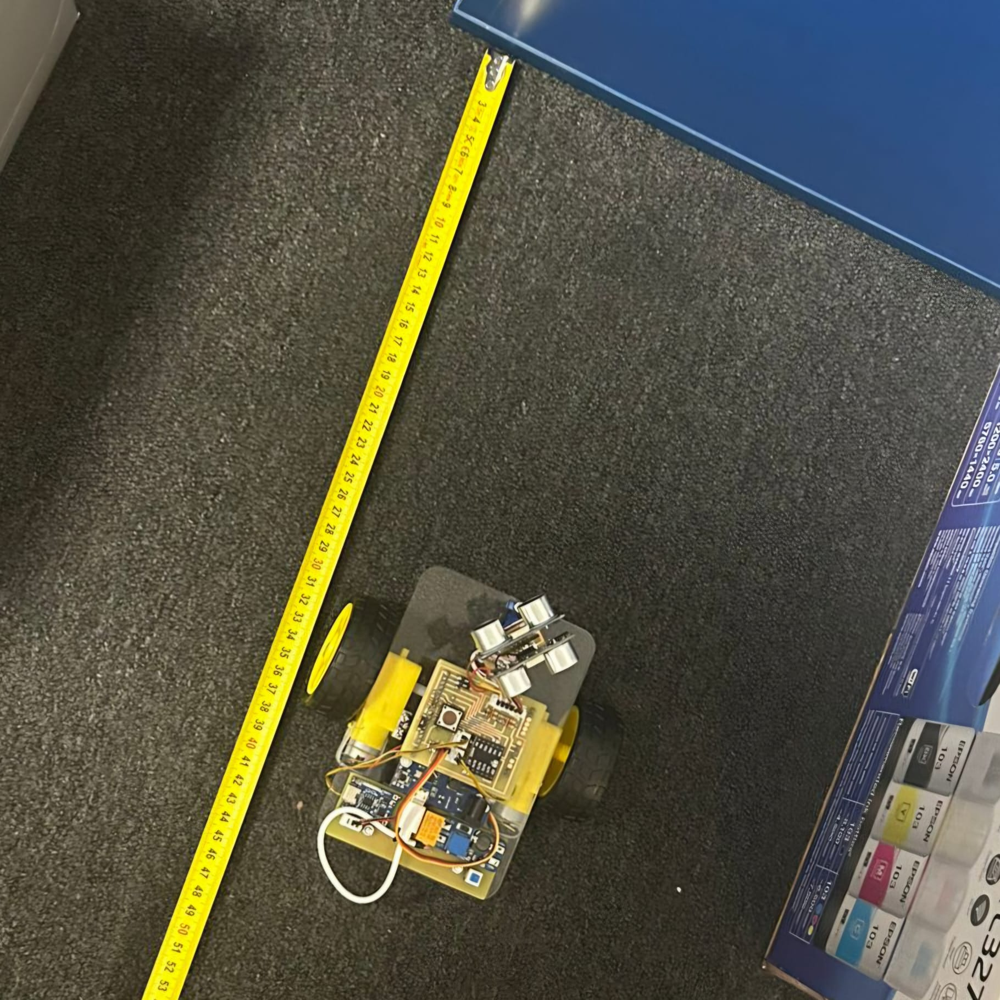

# Autonomous Mobile Robot for Indoor Exploration, Mapping, and Goal-Directed Navigation (named WALL-E)

**Institutional Affiliation:** Technical University of Cluj-Napoca (UTCN)  
**Faculty:** Faculty of Automation and Computer Science
**Specialization:** Automation and Applied Informatics/n
**Authors:** Bozomală Ștefan & Anechitei Bianca

---

## Abstract

This repository contains the embedded software architecture and control firmware for **WALL-E**, an autonomous mobile robotic platform designed for indoor spatial exploration, real-time radar occupancy mapping, and reactive goal-directed navigation. Built around an **ESP8266 (Wemos D1 R2)** microcontroller, the system integrates dual ultrasonic telemetry, servo-actuated turret scanning, proportional active safety braking, smooth acceleration ramping, and a comprehensive Human-Machine Interface (HMI) served locally via an asynchronous HTTP web server with mDNS resolution (`http://walle.local`).

---

## System Architecture & Hardware Configuration

The hardware topology is optimized for differential drive locomotion and multi-directional environmental perception. 

### Component Allocation Table

| Subsystem | Component / Model | Microcontroller Interface (Pin Mapping) | Function Description |
| :--- | :--- | :--- | :--- |
| **Locomotion Actuation** | L298N Dual H-Bridge Driver | `ENABLE` (D0/GPIO16)<br>`IN1` (D4/GPIO2), `IN2` (D5/GPIO14)<br>`IN3` (D6/GPIO12), `IN4` (D7/GPIO13) | Bidirectional motor velocity and directional control via PWM. |
| **Perception (Front)** | HC-SR04 Ultrasonic Sensor | `TRIG` (D8/GPIO15)<br>`ECHO` (D1/GPIO5) | Frontal obstacle detection up to two meters. |
| **Perception (Rear)** | HC-SR04 Ultrasonic Sensor | `TRIG` (TX/GPIO1)<br>`ECHO` (RX/GPIO3) | Rear telemetry and backward spatial mapping. |
| **Sensor Orientation** | Standard Servo Motor | `SERVO` (D2/GPIO4) | Dynamic turret positioning for sweep-based scanning. |

---

## Firmware Core Methodologies & Algorithms

### 1. Motion Control and PWM Ramping
To prevent mechanical stress and current spikes caused by instantaneous velocity transitions, the firmware implements a software-based acceleration and deceleration ramp (`RAMP_STEP`). Target motor velocities are dynamically adjusted using timed execution loops, providing smooth operational transitions across forward, reverse, and rotational states.

### 2. Proportional Active Safety Braking
Collision avoidance is governed by a linear transfer function (`getProportionalSpeed`) that scales motor velocity relative to obstacle proximity:
* **Critical Zone ($\le 200 \text{ mm}$):** Immediate safety intervention enforcing zero velocity.
* **Deceleration Zone ($200 \text{ mm} \text{ to } 500 \text{ mm}$):** Proportional speed attenuation from maximum threshold down to minimum actuation voltage (`PWM_MINIM`).
* **Free Zone ($> 500 \text{ mm}$):** Unrestricted velocity operation.

### 3. Dual-Sensor Kinematic Radar Mapping (360° Spatial Reconstruction)
Environmental mapping is achieved through two complementary operational paradigms:
* **Static Servo Sweep:** The turret articulates through discrete angles while the chassis remains stationary, querying both front and rear sonars to populate a 72-slice polar array (`radarMap`).
* **Full-Body Rotational Scan (`performFullRotationScan`):** The chassis executes controlled, step-by-step 360-degree rotations (72 increments of 5 degrees). Sensor fusion merges data from diametrically opposed front and rear sonars, applying distance offsets to reconstruct high-fidelity indoor occupancy maps with double-pass averaging (`averageRadarScans`).

### 4. Autonomous Reactive Maze Solver
When activated, the system executes an autonomous local navigation behavior (`executeAutonomousMovement`). It measures clearance across three directional sectors (Left, Center, Right) using the rotating turret, determines the vector of maximum open space, aligns the platform by pivoting on a single wheel, and executes controlled forward translation subject to active sonar safety overrides.

---

## Telemetry and Communication Framework

The embedded web server exposes a lightweight RESTful API for real-time monitoring and control:

* `GET /data` – Returns a JSON payload containing current movement state, front/back distance metrics, and the complete 72-point polar radar array (`map`).
* `GET /go` / `GET /back` – Linear translation commands.
* `GET /left` / `GET /right` – On-axis differential rotation commands.
* `GET /stop` – Halts actuation loops.
* `GET /scan` – Triggers static servo sweep telemetry.
* `GET /scan360` – Initiates full-body kinematic rotational mapping.
* `GET /maze` – Toggles the autonomous obstacle-avoidance protocol.

Network discovery is supported via Multicast DNS (mDNS), enabling seamless access to the operator HUD through the browser address `http://walle.local`.

---

## Human-Machine Interface (HMI)

The user interface (`hud.h`) provides multi-modal command ingestion:
* **Gamepad API:** Native browser integration for Xbox and PlayStation controllers, supporting analog thumbsticks and discrete button mapping for voice toggle, maze mode, and radar routines.
* **Web Speech API:** Natural Language Processing (NLP) bindings supporting Romanian vocal commands (*"înainte"*, *"stânga"*, *"scanează"*, *"labirint"*).
* **Keyboard Control:** Fallback control mapping utilizing standard `WASD` translational keys alongside shortcut tokens (`Z`, `X`, `M`).

---

## 📸 Media Gallery & Demonstrations

### 1. Hardware, UI, and Calibration Documentation
| Hardware Assembled (`robot.jpeg`) | Radar Occupancy HUD (`hud.png`) | Sensor Calibration (`measures.jpeg` / Excel) |
| :---: | :---: | :---: |
|  |  |  |

*Note: Sensor calibration measurements are fully documented and processed alongside `sensor_calibration.xlsx`.*

### 2. Video Demonstrations
* **[Search & Navigation Demo](media_gallery/searchdemo.mp4):** Demonstrates goal-directed movement and autonomous exploration routines.
* **[Vocal Command Interface](media_gallery/vocalcommand.mp4):** Illustrates hands-free operation utilizing Web Speech API parsing in Romanian (`ro-RO`).

### 3. Academic Outreach & Public Exhibitions (`nce1.mp4` & `nce2.mp4`)
The robotic platform was selected and utilized as an educational demonstration model (**material didactic**) during major public science dissemination events, including **Noaptea Cercetătorilor Europeni** (European Researchers' Night) and **Noaptea Muzeelor** (Museum Night), where the authors served as official exhibitors (`expozanți`).

---

## Compilation and Deployment

1. **Prerequisites:** Ensure the Arduino IDE or PlatformIO environment is configured with the **ESP8266 Board Support Package**.
2. **Required Dependencies:**
   * `ESP8266WiFi`
   * `ESP8266WebServer`
   * `Servo`
   * `ESP8266mDNS`
   * `NewPing`
3. **Configuration:** Update the network credentials in `main.cpp`:
   ```cpp
   #define WIFI_SSID "your_hotspot_ssid"
   #define WIFI_PASS "your_hotspot_password"
